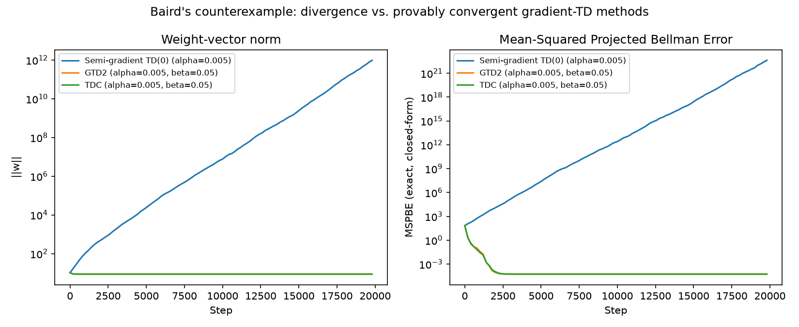
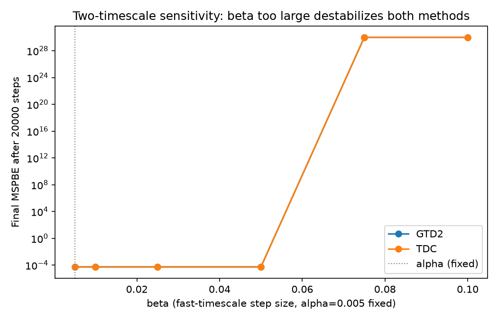
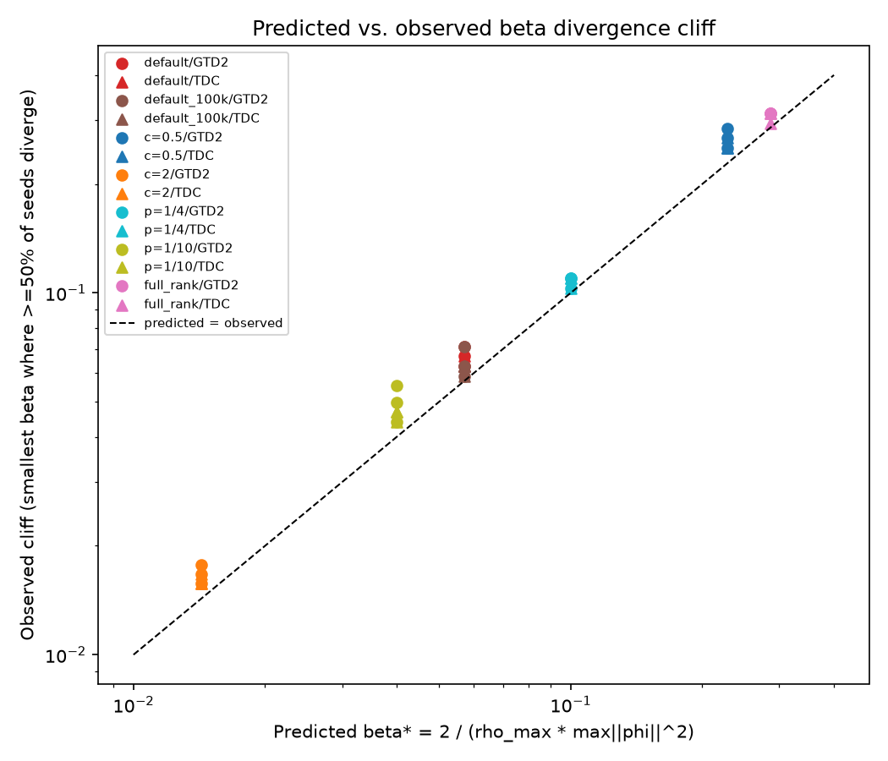

# gradient-td-rl

Baird's counterexample (Baird, 1995) reproduced from scratch, plus GTD2
and TDC — the two gradient-TD methods Sutton, Maei & Precup (2009)
introduced specifically to fix it: *"Fast Gradient-Descent Methods for
Temporal-Difference Learning with Linear Function Approximation"*.

This is a different axis from the rest of the stack
([function-approx-rl](https://github.com/ZahraAliAlharz/function-approx-rl),
[deep-q-rl](https://github.com/ZahraAliAlharz/deep-q-rl)): those are about
*how well* a function approximator learns on-policy. This one is about a
case where the on-policy intuition fails outright — **off-policy**
semi-gradient TD(0) with linear function approximation isn't just
slower or noisier here, it's *provably* divergent, on an example built
specifically to demonstrate that. `deep-q-rl`'s target-network ablation
found a *heuristic* fix for a related instability (freeze the
bootstrap target); this repo is the mathematically principled version of
that same problem: an algorithm with an actual convergence proof,
verified here against a closed-form, exactly-computed objective rather
than just inspecting a training curve.

## Install

```bash
pip install -e ".[dev]"
pytest -q
```

## The example

Seven states, two actions. "Solid" always moves to state 6 (the "top" of
the star); "dashed" moves to a uniformly random one of states 0-5.
Reward is 0 everywhere, so the true value function is `V = 0` under any
policy — trivial, and exactly representable by the linear function
class used here. The target policy `pi` always picks "solid"; the
behavior policy `b` picks "solid" with probability 1/7 and "dashed" with
probability 6/7 — so learning about `pi` while only ever acting under
`b` is genuinely off-policy, weighted by the importance ratio
`rho = pi(a|s) / b(a|s)` (7 for solid, 0 for dashed).

Each state has an 8-dimensional feature vector, deliberately
over-parameterized (Baird, 1995): states 0-5 get a 2 at their own index
plus a 1 at a feature shared by every state; state 6 gets a 1 at its own
index plus a 2 at that same shared feature. `w = 0` represents the true
value function exactly — the divergence that follows isn't a
representational problem.

## A derived fact, not an assumed one: the behavior policy's stationary distribution is exactly uniform

`tests/test_bairds_star.py` builds the behavior policy's 7x7 transition
matrix directly from the policy probabilities and the environment's
actual transition rule (not hand-asserted), and the result is exactly
`P[i, j] = 1/7` for every `i, j` — a consequence of the specific 1/7
(solid) vs. 6/7 (dashed, spread over 6 states) split, not something
built in on purpose. From there, the stationary distribution is also
exactly uniform, which is confirmed two independent ways: solving for
the eigenvector of `P^T` at eigenvalue 1 (closed-form linear algebra),
and simulating 200,000 real transitions and checking the empirical
visitation frequency matches (statistical cross-check).

## A real wrinkle: the feature matrix is rank-deficient

`np.linalg.matrix_rank(PHI) == 7`, not 8 — with 8 features but only 7
states, `Phi` cannot have 8 linearly independent columns, so there's a
genuine nonzero weight vector that maps to the all-zero value function.
This makes `Phi^T D Phi` singular, not just ill-conditioned, so the
closed-form MSPBE in `mspbe.py` uses the Moore-Penrose pseudoinverse
(`np.linalg.pinv`) rather than a plain solve — a detail that only shows
up once you actually check the rank instead of assuming a standard
linear-algebra identity applies unmodified.

## Computing the true objective exactly, not estimating it

Because the whole chain is 7 states, the Mean-Squared Projected Bellman
Error — the exact objective GTD2 and TDC are proven to perform stochastic
gradient descent on — can be computed in closed form at every step of
training, using the real feature matrix, the real (uniform) stationary
distribution, and the real target-policy transition matrix:

```
MSPBE(w) = (Phi^T D delta_bar(w))^T (Phi^T D Phi)^+ (Phi^T D delta_bar(w))
```

`tests/test_mspbe.py` cross-checks this closed-form computation against
an independently coded second computation (build the exact D-weighted
projection operator, project the Bellman target, measure the squared
distance directly) — the same "two independent code paths must agree"
check used for the BFS-vs-value-iteration cross-check in
`tabular-control-rl` and the finite-difference gradient check in
`deep-q-rl`.

## Results

### 1. Naive semi-gradient TD(0) diverges; GTD2 and TDC converge to the exact MSPBE minimum

20,000 steps, same seed, same starting weights (the classic
`[1,1,1,1,1,1,10,1]` initialization from Sutton & Barto, 2018, Fig. 11.2):



| | start MSPBE | end MSPBE | end &#124;&#124;w&#124;&#124; |
|---|---|---|---|
| Semi-gradient TD(0), alpha=0.005 | 67.6 | 4.2 x 10^22 | 9.6 x 10^11 |
| GTD2, alpha=0.005, beta=0.05 | 67.6 | 5.4 x 10^-5 | 8.76 |
| TDC, alpha=0.005, beta=0.05 | 67.6 | 5.4 x 10^-5 | 8.76 |

Naive TD doesn't drift or wobble — it blows up exponentially (22 orders
of magnitude in MSPBE over 20,000 steps), confirmed as sustained, not
transient, growth. GTD2 and TDC both land essentially exactly on the
true fixed point (`MSPBE approx 0`, the true value function being
`V = 0`), with the weight norm actually *shrinking* slightly from its
initial value rather than growing.

### 2. The target network wasn't an isolated hack — this is the same instability, with a proof attached

`deep-q-rl`'s ablation found that disabling its target network caused
real numerical divergence (`RuntimeWarning: overflow encountered in
matmul`). That was a heuristic fix (freeze the bootstrap target
periodically) discovered to help empirically. Baird's star is the
textbook example showing *why* bootstrapping off a moving,
off-policy-reweighted target can diverge in principle, and GTD2/TDC are
the version of "fix the target" with an actual convergence guarantee,
verified here against the exact objective rather than inferred from a
training curve not blowing up.

### 3. The step-size cliff has a derivable cause, and it isn't the two-timescale explanation I started with



The original beta sweep above (alpha=0.005 fixed) showed both methods
diverging somewhere between beta=0.05 (stable) and beta=0.075 (diverges),
and I initially attributed this to the two-timescale requirement being
"violated in the other direction." That explanation doesn't actually hold
up: GTD2 and TDC share the exact same update for the auxiliary vector `v`,
`v += beta*rho*(delta - phi@v)*phi`, and projecting that update onto the
current `phi` shows the existing value of `v` along `phi` gets rescaled by
`(1 - beta*rho*||phi||^2)` every step. Once `beta*rho*||phi||^2` exceeds 2,
that factor's magnitude exceeds 1 and `v` (and from there `w`) can grow
without bound. That gives a predicted cliff

```
beta* = 2 / (rho_max * max_s ||phi(s)||^2)
```

with no `alpha` term in it at all. For Baird's star, `rho_max=7` (the
importance ratio on "solid" steps) and `||phi(s)||^2=5` for every state, so
`beta* = 2/35 ≈ 0.057` — sitting exactly between the observed stable and
divergent betas above. This is the same style of argument behind
step-size stability limits for LMS-type stochastic updates (`x += mu*e*phi`
needs `mu*||phi||^2 < 2`); I haven't verified a citable source for this
exact instantaneous form, so take the analogy as structural, not a citation.

`experiments/sweep_beta_cliff.py` tests this prediction across six setups
that each move it: scaling every feature (`c=0.5`, `c=2`), changing the
behavior policy's `P(solid)` (`1/4`, `1/10`), and a full-column-rank
variant that drops Baird's deliberate 8th shared feature in favor of
one-hot features (rank 7, not 7-of-8). 15 beta values per setup (0.6x–1.6x
the prediction), both algorithms, 3 alpha values, 10 seeds each:

| Setup | Predicted beta* | Observed cliff (range, GTD2/TDC x alpha) |
|---|---|---|
| Default (Baird's star, rank-deficient) | 0.057 | 0.063 – 0.071 |
| Default, 100,000 steps | 0.057 | 0.059 – 0.071 |
| Features x 0.5 | 0.229 | 0.251 – 0.284 |
| Features x 2 | 0.014 | 0.016 – 0.018 |
| P(solid) = 1/4 | 0.100 | 0.103 – 0.110 |
| P(solid) = 1/10 | 0.040 | 0.044 – 0.055 |
| Full-rank features (one-hot, rank 7) | 0.286 | 0.294 – 0.314 |



The prediction holds across all six setups, including the full-rank one:
**the cliff is not specific to Baird's rank-deficient construction.** It's
the general step-size bound on `v`'s own update, independent of whether
`Phi` has full column rank.

Caveats, not swept under the rug:

- The bound is a necessary condition for `v`'s recursion treating `w` as
  fixed (the two-timescale assumption), not a full joint-stability proof
  of the coupled `(v, w)` system — which is likely why the observed cliff
  sits consistently *above* the prediction (3-25% higher) rather than
  exactly on it: crossing the bound makes growth possible, not
  instantaneous, so a finite run needs some further steps to actually
  blow past the divergence threshold.
- That finite-horizon gap shrinks with more steps: the default setup's
  100,000-step observed cliff (0.059-0.071) sits closer to the 0.057
  prediction than the 20,000-step one (0.063-0071) does.
- Alpha does shift the observed cliff slightly (e.g. default setup: 0.063
  at alpha=0.001 vs. 0.071 at alpha=0.01) — "fails at the same beta
  regardless of alpha" was never actually tested in the original sweep,
  which only used alpha=0.005. The effect is real but small next to the
  predicted bound's own range across setups (0.014 to 0.286, a 20x span).

## Repository layout

```
src/gradient_td_rl/
  envs/bairds_star.py   # the 7-state MDP: feature matrix (+ scale/full-rank variants), transition matrices, stationary distribution, predicted_beta_cliff()
  mspbe.py                # closed-form Mean-Squared Projected Bellman Error (2 independent code paths)
  agents/semi_gradient_td.py  # naive off-policy TD(0) (expected to diverge)
  agents/gtd2.py               # GTD2 (Sutton, Maei & Precup, 2009)
  agents/tdc.py                 # TDC / GTD with gradient correction
  metrics.py                     # training loop, tracks ||w|| and exact MSPBE jointly
  vectorized.py                   # seed-vectorized GTD2/TDC update, cross-checked against the scalar classes above; used by the beta-cliff sweep
  train.py                       # single-run CLI
experiments/
  sweep_bairds_star.py            # generates both results/bairds_*.png figures
  sweep_beta_cliff.py              # tests predicted_beta_cliff() against simulation across 6 setups; generates results/beta_cliff.csv and results/beta_cliff_predicted_vs_observed.png
tests/                              # includes the rank-deficiency, cross-check, and vectorized-vs-scalar agreement tests described above
```

## Usage

```bash
# Single run from the CLI
python -m gradient_td_rl.train --algorithm tdc

# Full experiment that regenerates the figures above
python experiments/sweep_bairds_star.py

# Tests predicted_beta_cliff() against simulation across 6 setups (~9 min)
python experiments/sweep_beta_cliff.py
```

## What I'd do next

- Implement Emphatic TD (Sutton, Mahmood & White, 2016), a different
  (simpler-to-state, trickier-to-tune) fix for the same off-policy
  divergence problem, and compare its convergence rate to GTD2/TDC here.
- Replace the necessary-condition argument behind `beta*` with an actual
  joint-stability proof of the coupled `(v, w)` system, since the
  consistent (if small) gap between predicted and observed cliffs
  suggests the current bound isn't the full story.
- Try Double Q-learning-style target estimation in `deep-q-rl` and see
  whether it closes any of the gap to the guaranteed convergence shown
  here, now that there's a concrete, provably-correct comparison point.

## References

- Baird, L. (1995). Residual algorithms: Reinforcement learning with
  function approximation. *ICML*.
- Sutton, R. S., Maei, H. R., & Precup, D. (2009). Fast gradient-descent
  methods for temporal-difference learning with linear function
  approximation. *ICML*.
- Sutton, R. S., & Barto, A. G. (2018). *Reinforcement Learning: An
  Introduction* (2nd ed.), Chapter 11 (the deadly triad, Baird's
  counterexample, gradient-TD methods).

## License

MIT — see [LICENSE](LICENSE).
